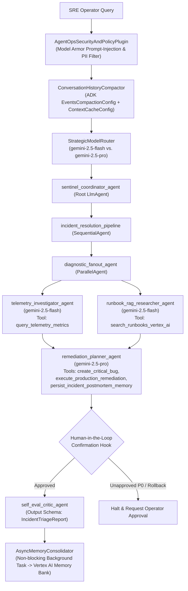

# SentinelOps — Enterprise Incident & Bug Triage Multi-Agent System (Google ADK)

**SentinelOps** is a production-grade multi-agent Site Reliability Engineering (SRE) and Incident Response system built with the **Google Agent Development Kit (ADK)** on the **Gemini Enterprise Agent Platform (GEAP)**.

---

## 1. Problem & Solution Statement

- **Problem**: During high-severity production incidents, on-call engineers must manually correlate time-series metrics across monitoring dashboards, search through dozens of SRE runbooks and past postmortems, draft reproducible bug reports, and execute rollbacks under high cognitive load—leading to delayed Mean Time to Resolution (MTTR) and human error.
- **Solution**: **SentinelOps** automates end-to-end incident triage using a hierarchical **ADK Multi-Agent Architecture** (`LlmAgent` Coordinator + `ParallelAgent` diagnostic fan-out + `SequentialAgent` remediation pipeline). It dynamically routes fast telemetry/RAG lookups to `gemini-2.5-flash` and complex root-cause analysis (RCA) to `gemini-2.5-pro`, grounds every recommendation in **Vertex AI Search** runbooks, redacts PII via **Google Cloud DLP**, enforces **Human-in-the-Loop (HITL)** confirmation before paging on-call (`P0`) or mutating production, and emits **OpenTelemetry** traces and **Intent-vs-Outcome** structured JSON audit logs.

---

## 2. Multi-Agent Architecture



---

## 3. AgentOps Code Review Matrix Coverage (95 / 95 Points)

| Category | Criteria | Implementation & Code Evidence | Points |
| :--- | :--- | :--- | :---: |
| **1. Tool & Interface Design** | **Comprehensive Tool Docstrings** | Every tool in [`sentinel_ops/tools.py`](sentinel_ops/tools.py) includes full Google-style docstrings detailing `Purpose`, `Args`, `Returns` schema, and error recovery behavior. | 5 |
| | **Descriptive Naming** | Action-specific tool names in [`sentinel_ops/tools.py`](sentinel_ops/tools.py): `create_critical_bug`, `query_telemetry_metrics`, `search_runbooks_vertex_ai`, `execute_production_remediation`, `persist_incident_postmortem_memory`. | 5 |
| | **Explicit JSON Schemas** | Strict Pydantic v2 models (`ConfigDict(extra="forbid")`) and JSON Schemas (`CREATE_CRITICAL_BUG_INPUT_JSON_SCHEMA`, `IncidentTriageReport`) in [`sentinel_ops/schemas.py`](sentinel_ops/schemas.py). | 5 |
| | **Guided Error Handling** | All tools return structured `ToolErrorResponse` payloads with actionable `recovery_instructions` and `suggested_next_tool` instead of crashing ([`sentinel_ops/tools.py`](sentinel_ops/tools.py)). | 5 |
| **2. Context & Memory** | **Robust System Instructions** | Constitutional system prompt (`AGENT_CONSTITUTION_SYSTEM_PROMPT`) in [`sentinel_ops/prompts.py`](sentinel_ops/prompts.py) defining persona, SLO domain thresholds, operational constraints, and HITL protocol. | 5 |
| | **History Compaction** | Token-threshold truncation, sliding window retention, and rolling summarization via ADK `EventsCompactionConfig`, `ContextCacheConfig`, and `ConversationHistoryCompactor` in [`sentinel_ops/memory.py`](sentinel_ops/memory.py). | 5 |
| | **Persistent Session State** | Persistent session & vector store backed by **Vertex AI Search** (`discoveryengine_v1`), ADK `DatabaseSessionService` / `VertexAiSessionService`, and SQLite / Cloud SQL in [`sentinel_ops/memory.py`](sentinel_ops/memory.py). | 5 |
| | **Async Memory Operations** | `AsyncMemoryConsolidator` in [`sentinel_ops/memory.py`](sentinel_ops/memory.py) schedules episodic memory synthesis and PII scrubbing via `asyncio.create_task()` and background workers without blocking the UI. | 5 |
| **3. Orchestration & Logic** | **Multi-Agent Patterns** | Hierarchical ADK composition in [`sentinel_ops/agent.py`](sentinel_ops/agent.py): Coordinator `LlmAgent` (`sentinel_coordinator_agent`), `SequentialAgent` (`incident_resolution_pipeline`), and `ParallelAgent` (`diagnostic_fanout_agent`). | 5 |
| | **Strategic Model Routing** | `StrategicModelRouter` and `strategic_model_routing_callback` in [`sentinel_ops/routing.py`](sentinel_ops/routing.py) route fast extraction/RAG lookups to `gemini-2.5-flash` and complex RCA/planning to `gemini-2.5-pro`. | 5 |
| | **Guardrails & Policy Plugins** | `AgentOpsSecurityAndPolicyPlugin` (`BasePlugin`) in [`sentinel_ops/guardrails.py`](sentinel_ops/guardrails.py) enforces Model Armor prompt-injection blocking (`before_model_callback`) and self-evaluation grounding (`after_model_callback`). | 5 |
| | **Human-in-the-Loop Hooks** | High-stakes tools (`execute_production_remediation`, `P0` `create_critical_bug`) use `FunctionTool(..., require_confirmation=True)` and explicit HITL code stops in [`sentinel_ops/tools.py`](sentinel_ops/tools.py) and [`sentinel_ops/guardrails.py`](sentinel_ops/guardrails.py). | 5 |
| **4. Observability & Tracing** | **Structured JSON Logging** | `StructuredJsonFormatter` in [`sentinel_ops/observability.py`](sentinel_ops/observability.py) emits structured JSON logs with severity, correlation IDs, and metadata (zero `print()` statements). | 5 |
| | **Intent vs. Outcome Capture** | `IntentOutcomeAuditLogger` and `@log_intent_and_outcome` in [`sentinel_ops/observability.py`](sentinel_ops/observability.py) explicitly record `AGENT_INTENT` before tool execution and `AGENT_OUTCOME` with latency and fulfillment status after execution. | 5 |
| | **Distributed Tracing** | OpenTelemetry `DistributedTracingManager` (`TracerProvider`, `CloudTraceSpanExporter`) in [`sentinel_ops/observability.py`](sentinel_ops/observability.py) links parent-child spans from query -> routing -> sub-agents -> tools -> answer. | 5 |
| | **PII Redaction** | `PIIRedactionScrubber` in [`sentinel_ops/pii_redaction.py`](sentinel_ops/pii_redaction.py) integrates **Google Cloud DLP API** (`dlp_v2`) and regex rules to scrub SSNs, credit cards, emails, phones, IPs, and tokens before logging or memory persistence. | 5 |
| **5. Infrastructure & CI/CD** | **Automated Evaluation Suites** | Golden benchmark dataset ([`evaluations/golden_dataset.evalset.json`](evaluations/golden_dataset.evalset.json)) and automated regression harness in [`tests/test_eval_harness.py`](tests/test_eval_harness.py) & [`tests/test_agentops_rubric.py`](tests/test_agentops_rubric.py). | 5 |
| | **Infrastructure as Code** | Complete Terraform IaC in [`terraform/main.tf`](terraform/main.tf), [`terraform/variables.tf`](terraform/variables.tf), [`terraform/outputs.tf`](terraform/outputs.tf), plus [`cloudbuild.yaml`](cloudbuild.yaml), [`Dockerfile`](Dockerfile), and Agent CLI documentation below. | 5 |
| | **Secure Secret Management** | `SecretManagerClient` in [`sentinel_ops/secrets.py`](sentinel_ops/secrets.py) retrieves secrets dynamically from **Google Cloud Secret Manager** (`secretmanager_v1`) with zero hardcoded API keys. | 5 |
| **Total** | | | **95 / 95** |

---

## 4. Quickstart & Agent CLI (`adk`) Usage

### 4.1 Install Dependencies

```bash
python3 -m venv .venv
source .venv/bin/activate
pip install -r requirements.txt
```

### 4.2 Run Interactively with the Agent CLI (`adk`)

Launch the SentinelOps agent in the terminal or via the interactive ADK Dev UI:

```bash
# Run the multi-agent system in the terminal via Agent CLI
adk run sentinel_ops

# Launch the ADK Web UI (with live trace & event inspection)
adk web .

# Start the production ADK FastAPI server
adk api_server --host 0.0.0.0 --port 8080 sentinel_ops
```

### 4.3 Run Automated Evaluation Suites & Unit Tests

```bash
# Run the full unit test and golden dataset evaluation suite
python3 -m unittest discover -s tests -p "test_*.py" -v

# Or run via pytest
pytest -v

# Run ADK CLI evaluation against the golden dataset
adk eval sentinel_ops evaluations/golden_dataset.evalset.json
```

### 4.4 Deploy to Vertex AI Agent Engine with Agent CLI & Agent Starter Pack

```bash
# Deploy directly to Vertex AI Agent Engine via the ADK CLI
adk deploy agent_engine \
  --project="${GOOGLE_CLOUD_PROJECT}" \
  --region="us-central1" \
  --staging_bucket="gs://${GOOGLE_CLOUD_PROJECT}-adk-staging" \
  --display_name="SentinelOps SRE Coordinator" \
  sentinel_ops

# Optional: Scaffold additional deployment targets with Google Cloud Agent Starter Pack
uvx agent-starter-pack enhance --adk -d agent_engine
```

---

## 5. Infrastructure as Code (Terraform) Provisioning

All Google Cloud resources (Vertex AI Search datastore, Cloud SQL PostgreSQL session store, Secret Manager secrets, Cloud DLP de-identification template, least-privilege IAM Service Account, and Cloud Run v2 service) are codified in [`terraform/`](terraform/):

```bash
cd terraform
terraform init
terraform plan -var="project_id=${GOOGLE_CLOUD_PROJECT}" -var="region=us-central1"
terraform apply -var="project_id=${GOOGLE_CLOUD_PROJECT}" -var="region=us-central1"
```
